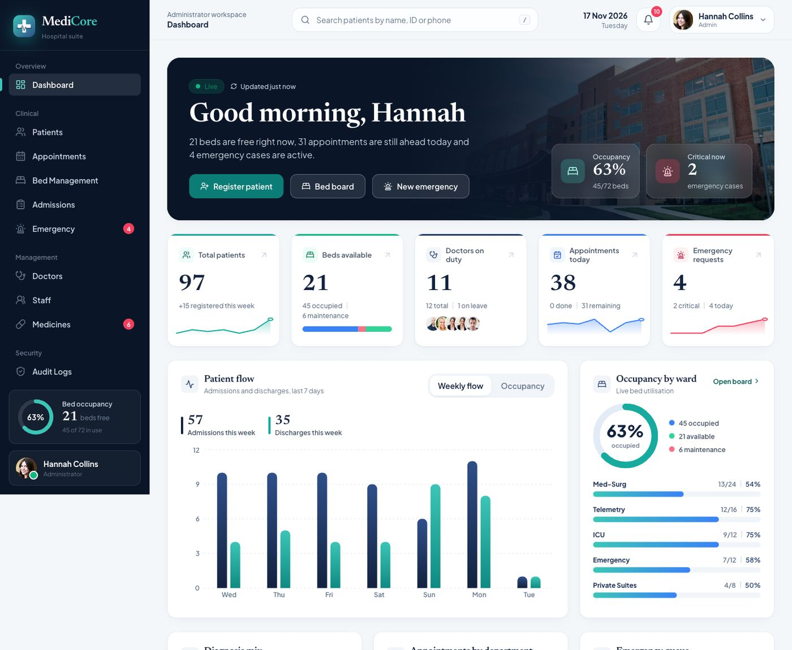
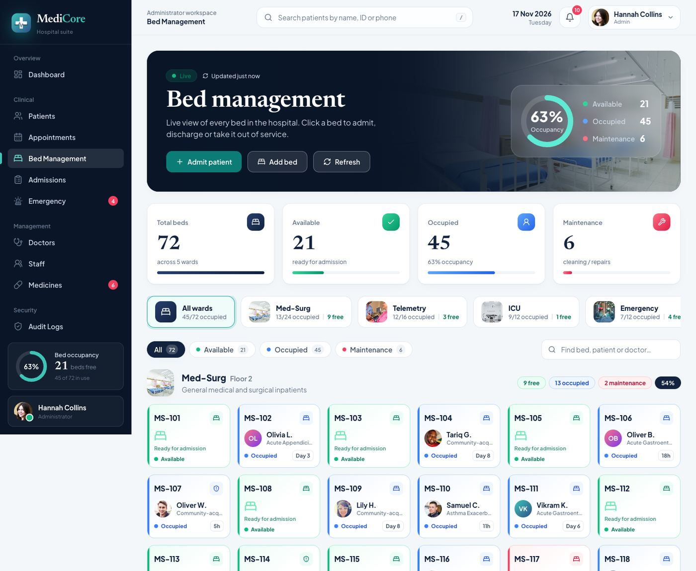
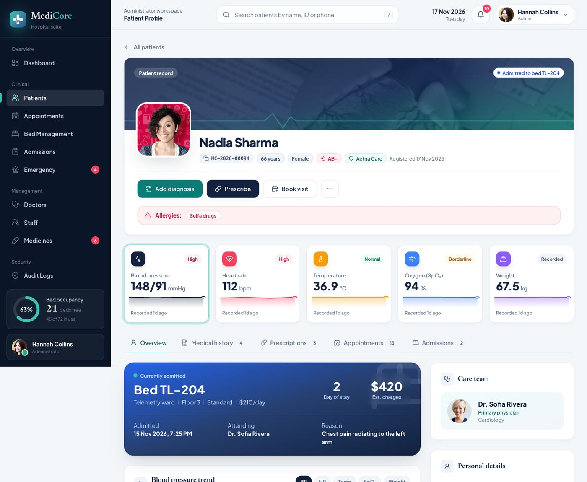
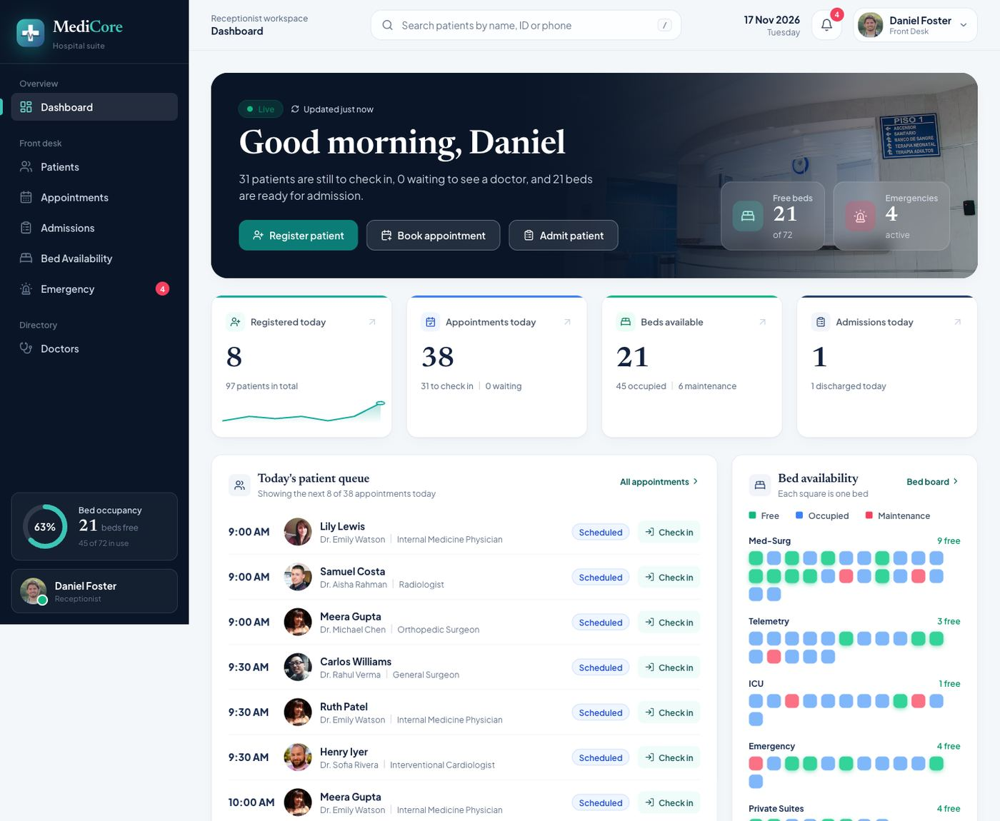
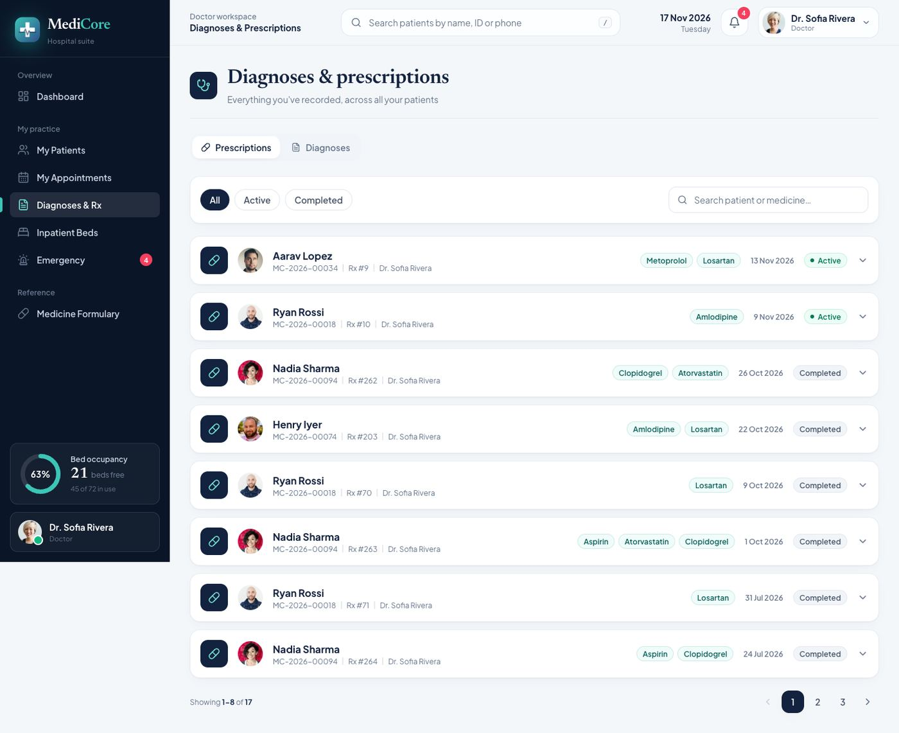
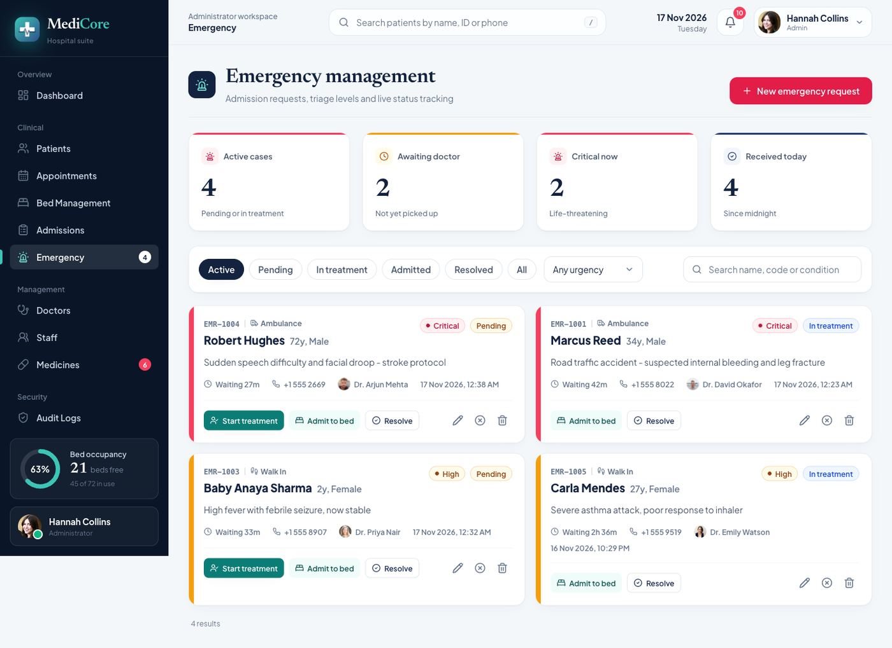
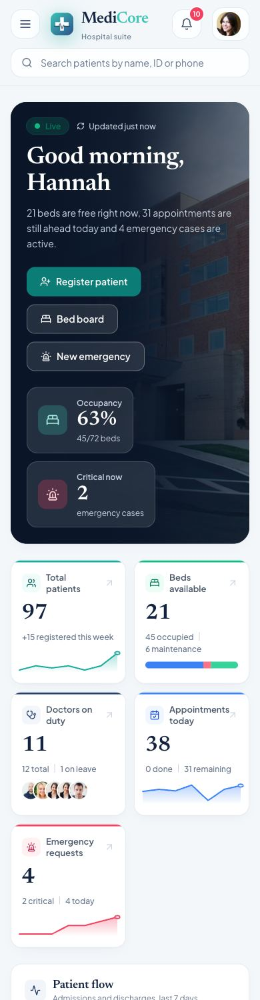
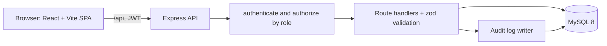

# MediCore Hospital Management System

[](LICENSE)
[](backend/)
[](frontend/)
[](database/)
[](docker-compose.yml)

MediCore is a full-stack hospital management system covering patients, appointments, bed and ward management, admissions, emergency intake, pharmacy stock, clinical records and a security audit trail. Access is role-based: every API route is protected by JWT authentication and an `authorize()` middleware, so permissions are enforced in the backend and not only hidden in the UI.

<p align="center">
  
</p>

## Contents

- [Screenshots](#screenshots) | [Architecture](#architecture) | [Features by role](#features-by-role) | [Tech stack](#tech-stack)
- [Quick start](#quick-start) | [Run with Docker](#run-the-full-stack-with-docker) | [Demo credentials](#demo-credentials)
- [Security notes](#security-notes) | [Cloud and DevOps](#cloud--devops-deployment) | [License](#license)

## Screenshots

All data shown is simulated demo data.

<table>
<tr>
<td width="50%"><b>Bed management</b><br></td>
<td width="50%"><b>Patient profile</b><br></td>
</tr>
<tr>
<td width="50%"><b>Receptionist dashboard</b><br></td>
<td width="50%"><b>Clinical records (doctor)</b><br></td>
</tr>
<tr>
<td width="50%"><b>Emergency queue</b><br></td>
<td width="50%"><b>Mobile layout</b><br></td>
</tr>
</table>

## Architecture



In production the SPA is served by nginx, which proxies `/api` to the Express API; MySQL runs next to it (container or local).

## Features by role

### Admin
- Hospital-wide dashboard: occupancy, admissions, appointments, emergency load and trends (charts)
- Full CRUD for patients, doctors, departments, staff accounts, beds and medicines
- Medicine inventory with stock adjustments
- Bed Management: create, edit and delete beds; allocate, discharge, release, set maintenance
- Clinical records and prescriptions overview
- Audit log viewer with filters and statistics (including denied-access and failed-login events)
- Delete appointments and emergency requests

### Doctor
- Personal dashboard with today's appointments and assigned patients
- Patient profiles: clinical summary, admissions, appointments, records and prescriptions
- Create medical records and prescriptions; update clinical notes on patients
- Update appointment and emergency statuses
- Read-only access to beds, admissions, departments and doctors; medicine catalogue search

### Receptionist
- Front-desk dashboard: arrivals, bed availability, emergency queue
- Register and edit patients
- Book, reschedule and update appointments
- Admit and discharge patients, allocate beds, change bed status
- Register emergency requests and admit them directly to a bed

## Tech stack

| Layer | Technology |
|-------|------------|
| Frontend | React 18, Vite 5, Tailwind CSS 3, Recharts, Lucide icons, React Router 6 |
| Backend | Node.js, Express 4, mysql2, JSON Web Tokens, bcryptjs, zod, helmet, cors, express-rate-limit, morgan |
| Database | MySQL 8 (InnoDB) |

## Prerequisites

- Node.js 18 or newer
- MySQL 8 with a user that can create databases: either your own server, or the bundled Docker one (requires Docker with Compose v2)

## Quick start

From the repository root:

```bash
npm run install:all                    # backend + frontend dependencies
cp backend/.env.example backend/.env   # Windows: copy backend\.env.example backend\.env
# edit backend/.env and set JWT_SECRET to a long random value (16+ characters)
npm run db:up                          # optional: start MySQL in Docker (see below)
npm run db:setup                       # create database, tables and demo data
npm run dev                            # API on :5000 and frontend on :5173
```

`npm run dev` runs the backend and the frontend in one terminal using a POSIX shell (macOS, Linux, WSL, Git Bash). On plain Windows, run `npm run dev:backend` and `npm run dev:frontend` in two terminals. Other root scripts: `npm run build` (production build of the frontend into `frontend/dist`) and `npm test` (runs the backend integration tests in `backend/tests/`, which need the MySQL database from `backend/.env` to be running and seeded).

## Project structure

```
medicore/
├── docker-compose.yml        # local MySQL 8 for development
├── package.json              # root convenience scripts
├── README.md
├── backend/
│   ├── .env.example
│   ├── package.json
│   └── src/
│       ├── server.js         # app wiring, health check, route mounting
│       ├── config/           # env.js, db.js (pool + query helpers)
│       ├── middleware/       # auth.js (authenticate, authorize), error.js
│       ├── routes/           # *.routes.js, one file per resource
│       ├── services/         # admission.service.js (transactional bed logic)
│       └── utils/            # audit.js, helpers.js
├── database/
│   ├── schema.sql            # tables, keys, constraints
│   ├── seed.js               # demo data
│   └── setup.js              # creates DB, applies schema, seeds data
├── deploy/                   # AWS CLI, Terraform, Ansible, CloudWatch, Kubernetes
├── docs/screenshots/         # README images
├── docker-compose.yml        # local MySQL
├── docker-compose.prod.yml   # db + schema init + api + web
├── Jenkinsfile
└── frontend/
    ├── vite.config.js        # dev server on 5173, /api proxy
    └── src/
        ├── api/              # fetch client
        ├── components/       # layout + UI kit
        ├── context/          # auth, toasts
        ├── hooks/ lib/       # helpers and constants
        └── pages/            # per-role dashboards, Beds, PatientProfile, ...
```

## Installation

### 0. Database (Docker option)

`docker-compose.yml` starts MySQL 8 with a `medicore` database, a named volume (`medicore-mysql-data`) so data survives restarts, and a healthcheck:

```bash
docker compose up -d --wait    # same as: npm run db:up
```

The root password defaults to `medicore_dev`, which is also the `DB_PASSWORD` value in `backend/.env.example`, so the copied `.env` works unchanged. To use another password or host port, set `DB_PASSWORD` / `DB_PORT` in your shell or in a root-level `.env` file (git-ignored) when starting Compose, and use the same values in `backend/.env`. The password is only applied when the volume is first created; to start over, run `docker compose down -v` (this deletes the database).

Skip this step if you already run MySQL yourself.

### 1. Backend

```bash
cd backend
cp .env.example .env        # Windows: copy .env.example .env
# edit .env: set DB_PASSWORD (and DB_USER/DB_HOST if needed) and a long random JWT_SECRET
npm install
npm run db:setup            # creates the database, tables and demo data
npm run dev                 # API on http://localhost:5000
```

> `npm run db:setup` **drops existing MediCore tables** before recreating them and loading demo data. Do not run it against a database holding data you want to keep.

Environment variables (`backend/.env`):

| Variable | Default | Purpose |
|----------|---------|---------|
| `PORT` | `5000` | API port |
| `NODE_ENV` | `development` | Set to `production` for deployments |
| `CLIENT_ORIGIN` | `http://localhost:5173` | Allowed CORS origin(s), comma separated |
| `DB_HOST` / `DB_PORT` | `localhost` / `3306` | MySQL location |
| `DB_USER` / `DB_PASSWORD` | `root` / (set this) | MySQL credentials |
| `DB_NAME` | `medicore` | Database name |
| `JWT_SECRET` | (set this) | Token signing secret; use a long random value |
| `JWT_EXPIRES_IN` | `8h` | Token lifetime |

### 2. Frontend

```bash
cd frontend
npm install
npm run dev                 # http://localhost:5173
```

Vite proxies `/api` to `http://localhost:5000`. If the API runs elsewhere, set `VITE_API_PROXY` (for example `VITE_API_PROXY=http://localhost:5001 npm run dev`, or put it in `frontend/.env`).

### Root shortcuts (optional)

From the repository root: `npm run install:all`, `npm run db:up`, `npm run db:setup`, `npm run dev` (both servers), `npm run dev:backend`, `npm run dev:frontend`, `npm run build`, `npm test`.

## Demo credentials

| Role | Email | Password |
|------|-------|----------|
| Admin | admin@medicore.com | Admin@123 |
| Doctor | doctor@medicore.com | Doctor@123 |
| Receptionist | reception@medicore.com | Reception@123 |

> **Demo only.** These accounts are created by `npm run db:setup` on a throwaway local database and use well-known passwords that are also printed in this README and the tests. Never expose a deployment seeded with them to the internet; delete or change these users first.

## Role permission matrix

Derived from the `authorize()` calls in `backend/src/routes/*.routes.js`. A = Admin, D = Doctor, R = Receptionist.

| Resource | View | Create | Update | Delete | Other |
|----------|------|--------|--------|--------|-------|
| Dashboard | own role's dashboard only | - | - | - | - |
| Patients | A D R | A R | A R (clinical notes: A D) | A | Create records and prescriptions: A D |
| Appointments | A D R | A R | A R (status: A D R) | A | - |
| Beds | A D R | A | A | A | Status change, allocate, discharge: A R |
| Admissions | A D R | A R | - | - | Discharge: A R |
| Emergency | A D R | A R | A R (status: A D R) | A | Admit to bed: A R |
| Doctors | A D R | A | A | A | - |
| Departments | A D R | A | A | A | - |
| Staff | A | A | A | A | - |
| Medicines | A D | A | A | A | Stock adjustment: A |
| Clinical records / prescriptions | A D | - | - | - | - |
| Audit logs | A | - | - | - | - |

Any request outside a role's permissions returns `403` and writes an `ACCESS_DENIED` audit entry.

## Key screens

- **Dashboard**: a different view per role. Admin sees hospital KPIs, occupancy and activity charts; Doctor sees their schedule and assigned patients; Receptionist sees arrivals, free beds and the emergency queue.
- **Bed Management**: ward-by-ward view of beds with live status (available, occupied, cleaning, maintenance). Staff can allocate a patient, discharge, or change bed status. Allocation is transactional, so two users cannot book the same bed.
- **Patient Profile**: demographics, clinical summary, current admission and bed, appointment history, medical records and prescriptions in one place. Viewing a profile is recorded in the audit log.

Other screens: Patients, Appointments, Admissions, Emergency, Doctors, Staff, Medicines, Clinical, Audit Logs and My Profile.

## Database overview

Tables (`database/schema.sql`):

`users`, `departments`, `doctors`, `staff`, `patients`, `appointments`, `wards`, `beds`, `admissions`, `medical_records`, `medicines`, `prescriptions`, `prescription_items`, `emergency_requests`, `audit_logs`.

**Preventing double booking.** The `admissions` table has two generated, stored columns:

- `active_bed_key = IF(status = 'admitted', bed_id, NULL)`
- `active_patient_key = IF(status = 'admitted', patient_id, NULL)`

Each carries a `UNIQUE` index. Because `NULL` values are not considered equal in a unique index, only rows with status `admitted` participate, so at most one active admission can exist per bed and per patient, even under concurrent requests. On top of this, `admission.service.js` runs admission and discharge inside a transaction and locks the bed and patient rows with `SELECT ... FOR UPDATE`, so conflicts are detected cleanly before the constraint is ever hit.

## API overview

Base URL `http://localhost:5000/api`. Everything except `/health` and `/auth/login` requires `Authorization: Bearer <token>`. Roles: A = Admin, D = Doctor, R = Receptionist.

| Area | Endpoint | Roles |
|------|----------|-------|
| Health | `GET /health` | public |
| Auth | `POST /auth/login` | public (rate limited) |
| | `GET /auth/me`, `POST /auth/logout`, `PUT /auth/password` | any signed-in user |
| Dashboard | `GET /dashboard/admin`, `/dashboard/doctor`, `/dashboard/reception` | A, D, R respectively |
| Patients | `GET /patients`, `GET /patients/:id` | A D R |
| | `POST /patients`, `PUT /patients/:id` | A R |
| | `PATCH /patients/:id/clinical` | A D |
| | `POST /patients/:id/records`, `POST /patients/:id/prescriptions` | A D |
| | `DELETE /patients/:id` | A |
| Appointments | `GET /appointments` | A D R |
| | `POST /appointments`, `PUT /appointments/:id` | A R |
| | `PATCH /appointments/:id/status` | A D R |
| | `DELETE /appointments/:id` | A |
| Beds | `GET /beds`, `GET /beds/wards`, `GET /beds/available` | A D R |
| | `PATCH /beds/:id/status`, `POST /beds/:id/allocate`, `POST /beds/:id/discharge` | A R |
| | `POST /beds`, `PUT /beds/:id`, `DELETE /beds/:id` | A |
| Admissions | `GET /admissions` | A D R |
| | `POST /admissions`, `POST /admissions/:id/discharge` | A R |
| Emergency | `GET /emergency` | A D R |
| | `POST /emergency`, `PUT /emergency/:id`, `POST /emergency/:id/admit` | A R |
| | `PATCH /emergency/:id/status` | A D R |
| | `DELETE /emergency/:id` | A |
| Doctors | `GET /doctors`, `GET /doctors/:id` | A D R |
| | `POST /doctors`, `PUT /doctors/:id`, `DELETE /doctors/:id` | A |
| Departments | `GET /departments` | A D R |
| | `POST /departments`, `PUT /departments/:id`, `DELETE /departments/:id` | A |
| Staff | `GET /staff`, `POST /staff`, `PUT /staff/:id`, `DELETE /staff/:id` | A |
| Medicines | `GET /medicines`, `GET /medicines/meta`, `GET /medicines/search` | A D |
| | `POST /medicines`, `PUT /medicines/:id`, `PATCH /medicines/:id/stock`, `DELETE /medicines/:id` | A |
| Clinical | `GET /clinical/records`, `GET /clinical/prescriptions` | A D |
| Audit | `GET /audit`, `GET /audit/actions`, `GET /audit/stats` | A |

## Security notes

- Passwords are hashed with bcrypt; login compares against a dummy hash for unknown emails so response timing does not reveal which accounts exist.
- Authentication uses signed JWTs (`JWT_SECRET`, `JWT_EXPIRES_IN`). The user is reloaded from the database on every request, so deactivated accounts lose access immediately.
- Authorization is enforced server-side with `authorize(...roles)` on every router.
- `helmet` sets secure headers, CORS is restricted to `CLIENT_ORIGIN`, request bodies are capped at 1 MB, input is validated with zod, and queries are parameterised.
- The login endpoint is rate limited (30 attempts per 15 minutes per IP).
- Audit logging records logins, logouts, failed logins, password changes, data changes, patient profile views and `ACCESS_DENIED` events, with user, IP and severity.
- Secrets live in `backend/.env`, which is git-ignored. Never commit it, and use a long random `JWT_SECRET` outside local development.

## Images

Doctor, patient and staff photos are hotlinked from Unsplash and randomuser.me, so they need an internet connection to display. If an image fails to load, the UI falls back to an initials avatar.

## Troubleshooting

- **`ER_ACCESS_DENIED_ERROR`**: MySQL rejected the credentials. Check `DB_USER` and `DB_PASSWORD` in `backend/.env` and confirm MySQL is running on `DB_HOST:DB_PORT`. With the Docker database the user is `root` and the password is whatever `DB_PASSWORD` was when the volume was first created (default `medicore_dev`). If you changed it later, run `docker compose down -v` and `npm run db:up` to recreate the volume, or put the original password back in `backend/.env`.
- **"Could not connect to MySQL" on API start**: fix `.env`, then make sure `npm run db:up` (if using Docker) and `npm run db:setup` have been run.
- **Port already in use (`EADDRINUSE` / MySQL port 3306)**: stop the process using port 5000 (or 5173), or change `PORT` in `backend/.env` and set `VITE_API_PROXY` for the frontend. If a local MySQL already holds 3306, either stop it or start Docker on another port (`DB_PORT=3307 docker compose up -d --wait`) and set `DB_PORT=3307` in `backend/.env`.
- **CORS errors in the browser**: make sure `CLIENT_ORIGIN` matches the exact origin you open the app from (for example `http://localhost:5173`). Comma-separate multiple origins.
- **Broken or modified demo data**: run `npm run db:setup` again from `backend/` to drop and reseed everything.
- **"Too many login attempts"**: wait out the 15-minute rate-limit window or restart the API.

## Run the full stack with Docker

`docker-compose.prod.yml` starts MySQL, a one-shot `db-init` job, the API and the nginx-served frontend. On first start `db-init` creates the schema and loads the demo data; on later starts it detects the existing schema and exits without touching it.

```bash
DB_PASSWORD=choose-a-password JWT_SECRET=$(openssl rand -hex 32) \
  docker compose -f docker-compose.prod.yml up -d --build
# open http://localhost
```

Remember the demo-credentials warning above if you expose this beyond your machine.

## Cloud & DevOps deployment

Course-lab tooling that lives in `deploy/` and the repository root. Account-specific values (instance IDs, addresses, bucket names, key names) are placeholders; copy `deploy/ansible/inventory.ini.example` to `inventory.ini` (git-ignored) and fill in your own.

| Topic | Where | Status |
|---|---|---|
| EC2 instance, EBS volume, security group, S3 bucket | `deploy/aws-cli/create-infra.sh` (t3.micro, 20 GB gp3; set `KEY_NAME`, optionally `SSH_CIDR`) | Used to build the lab stack |
| Server bootstrap: swap, MySQL in Docker, systemd, nginx, nightly dump to S3 | `deploy/userdata.sh` | Used on the lab stack |
| CloudWatch agent, alarms, dashboard | `deploy/cloudwatch/` | Used on the lab stack; dashboard JSON uses placeholder IDs |
| Ansible website deployment | `deploy/ansible/deploy-website.yml` | Used on the lab stack |
| Docker images and Compose | `backend/Dockerfile`, `frontend/Dockerfile`, `docker-compose.prod.yml` | Authored; image build not verified in this repository |
| Terraform | `deploy/terraform/main.tf` | Authored; not applied or validated |
| Kubernetes Pod and Service | `deploy/k8s/medicore-pod.yaml` | Authored; no cluster used |
| CI/CD and DevSecOps (secrets scan, `npm audit`) | `Jenkinsfile` | Authored; no Jenkins server used |

Update a deployed site: `cd deploy/ansible && ansible-playbook -i inventory.ini deploy-website.yml`. Publish the dashboard: `aws cloudwatch put-dashboard --dashboard-name MediCore-Live --dashboard-body file://deploy/cloudwatch/dashboard.json` (replace the placeholder instance ID and account ID first).

## License

Released under the [MIT License](LICENSE).
